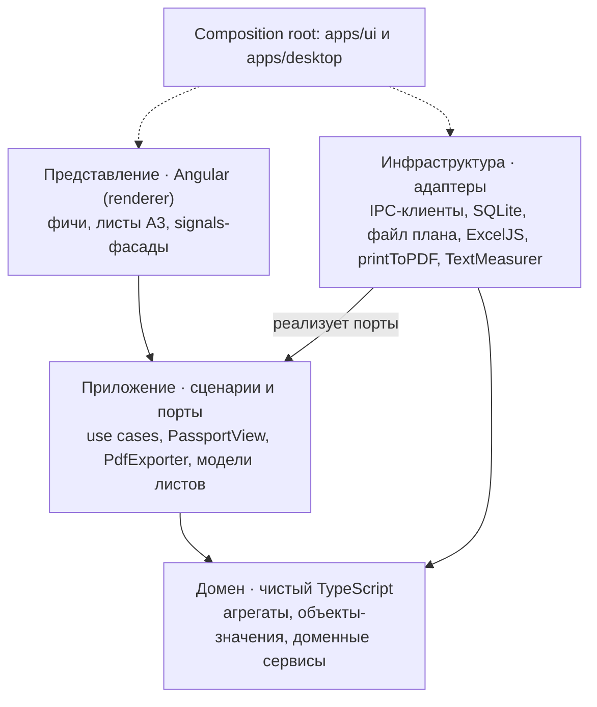
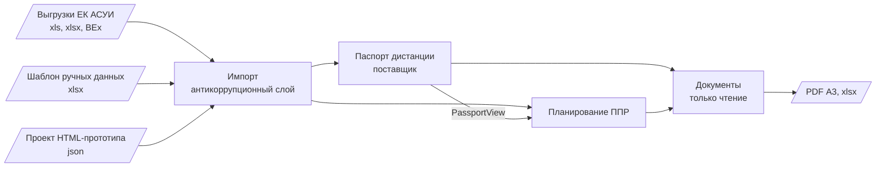

# editor-of-work — архитектурный документ

Автор — Манченко И. Г. Редакция от 20.10.2026.

> Документ описывает целевое устройство программы. Причины ключевых решений — в [ADR](adr/README.md). Примеры в документе вымышленные или обобщённые: реальные данные дистанции в репозиторий не добавляются.

## 1. Назначение и границы системы

editor-of-work — автономная настольная программа ПТО дистанции инфраструктуры для ведения паспортных данных дистанции и выпуска годовых документов: схем ППР, схемы дистанции и административного деления. Работает без сети на рабочем ПК, один пользователь, один файл проекта на год.

**Состав функций**

- **Паспорт дистанции** — справочные данные о главных путях, станциях и оргструктуре из таблиц паспорта (выгрузок ЕК АСУИ): границы ПЧУ, ПД и цехов; класс, группа и категория пути; грузонапряжённость и осевая нагрузка; установленные скорости; рельсы, шпалы и скрепления, балласт, пропущенный тоннаж; оси и границы станций; экспликации станционных путей и стрелочных переводов; переезды; территории ОКАТО. К ним добавляются данные ручного ввода: нормативы (периодичность ремонтов, виды работ и единицы, допуски), пары поездов по участкам, километры нестандартной длины. Хранится в SQLite по редакциям.
- **Импорт** — 17 форм таблиц паспорта (xlsx, «веб-страничные» xls, отчёты BEx) и шаблон ручных данных, который выдаёт сама программа; перечень форм — раздел 8.3.
- **Путевое развитие станций** — пути, стрелки, переезды, здания; таблица плюс правка мышью.
- **Схемы ППР на год** — общая схема дистанции, листы линейных участков (ПД), листы станций; работы с привязкой «км + пк» или к пути и стрелке станции; таблицы показателей и планов; PDF А3 сразу файлом.
- **Схема дистанции** — три варианта оформления: линейная в масштабе, топологическая, схема-таблица; PDF А3.
- **Административное деление** — таблица ПЧУ → ПД → границы, станции, протяжённости, стрелочные переводы; экспорт в xlsx, совместимый с Excel 2007, с формулами.

**Вне границ системы:** работа с ЕК АСУИ напрямую, многопользовательская работа и сервер, схемы ОДД переездов (это отдельный проект editor-of-tod).

**Пользователь:** начальник ПТО дистанции. Эталон поведения и вида листов — HTML-прототип «Редактор схем ППР», сделанный при проработке.

## 2. Требования и ограничения

Главное ограничение — среда рабочего ПК РЖД: без интернета, без установки с правами администратора, Excel 2007 для получателей таблиц.

**Функциональные**

1. Импорт выгрузок с предпросмотром изменений (что добавится, изменится, удалится) и журналом расхождений (станции без привязки к ПД, без оси и т. п.).
2. Редакции паспорта: каждая с датой введения; годовой проект ссылается на редакцию и воспроизводится с ней через годы.
3. Место работы задаётся текстом «227 км пк 4 – 228 км пк 10; 234 км пк 3», «227+350» или выбором пути/стрелки станции; протяжённость в км считается сама.
4. Планы текущего содержания и капитальных работ считаются по работам с долями по ПД; ручное значение допускается и помечается.
5. Листы А3 альбомные: шапка с грифом утверждения, схема, таблицы, условные обозначения; набор таблиц настраивается по типу листа.
6. Экспорт: PDF А3 без окна печати (один лист, выбранные, все в один файл); xlsx административного деления с формулами.
7. «Новый год»: копия справочных данных, перенос показателей «на 01.01», очистка работ.
8. Отмена и повтор действий в редакторах.

**Нефункциональные**

| Требование           | Значение                                                                  |
| -------------------- | ------------------------------------------------------------------------- |
| Платформа            | Windows 10/11 x64, без прав администратора                                |
| Поставка             | один portable exe, без установки                                          |
| Сеть                 | не требуется; никаких обращений во внешний мир, в том числе за шрифтами   |
| Сохранность данных   | атомарная запись файла, автосохранение, резервные копии                   |
| Совместимость файлов | файл любой старой версии открывается новой (миграции)                     |
| Печать               | PDF совпадает с предпросмотром; шрифты встроены (PT Sans, PT Sans Narrow) |
| Быстродействие       | перерисовка листа после правки < 200 мс; PDF из 30 листов < 30 с          |
| Архитектура          | DDD и Clean Architecture; домен без зависимостей от фреймворков           |
| Лицензия             | MIT, как у editor-of-tod; зависимости только со свободными лицензиями     |

## 3. Стек технологий

Angular + Electron + SQLite в монорепозитории Nx на TypeScript: Angular даёт DI для портов, Nx следит за границами слоёв, Electron — самодостаточный exe и точный PDF без окна печати.

| Задача                    | Выбор                                                                                  | Почему                                                                                           |
| ------------------------- | -------------------------------------------------------------------------------------- | ------------------------------------------------------------------------------------------------ |
| Язык                      | TypeScript (strict)                                                                    | один язык для домена, UI и main-процесса                                                         |
| Интерфейс                 | Angular (standalone-компоненты, signals)                                               | встроенный DI и InjectionToken для портов, реактивные формы для множества справочных форм        |
| Монорепозиторий           | Nx                                                                                     | теги и `enforce-module-boundaries`: домен не может импортировать ничего из инфраструктуры или UI |
| Рантайм                   | Electron                                                                               | свой Chromium (не зависит от WebView2 на ПК), `printToPDF`, диалоги файлов                       |
| Сборка exe                | electron-builder, цель `portable`                                                      | один exe без установки                                                                           |
| База паспорта             | SQLite через встроенный `node:sqlite` и адаптер Kysely                                 | синхронный быстрый доступ, один файл, транзакции                                                 |
| Миграции и запросы SQLite | Kysely (типизированный SQL) + свои SQL-миграции                                        | без тяжёлой ORM; схема прозрачна                                                                 |
| Файл проекта              | JSON + схема zod + цепочка миграций по версиям                                         | переносимый, читаемый, проверяемый при открытии                                                  |
| Excel                     | свой читатель на fflate ([ADR-0009](adr/0009-xlsx-reader.md)); писатель — в #19 и #32  | чтение выгрузок и запись xlsx с формулами для Excel 2007                                         |
| «Веб-страничные» xls      | разбор HTML-таблицы без библиотек                                                      | одна таблица в файле или лист `*.files/sheet001.htm` у frameset                                  |
| PDF                       | `webContents.printToPDF` в скрытом окне + pdf-lib для склейки                          | тот же движок, что и предпросмотр; формат А3 ставится кодом                                      |
| Графика листов            | SVG из Angular-шаблонов по модели листа                                                | вектор для печати, без canvas-библиотек                                                          |
| Шрифты                    | PT Sans, PT Sans Narrow (@fontsource, OFL)                                             | кириллица, лежат внутри программы                                                                |
| Тесты                     | Vitest (домен, приложение, адаптеры), Playwright для Electron (e2e + скриншоты листов) | как в editor-of-tod                                                                              |
| Качество кода             | ESLint (angular-eslint, Nx boundaries), oxlint, Prettier                               | как в editor-of-tod                                                                              |
| CI                        | GitHub Actions: lint, test, build; exe на `windows-latest` в Releases                  | воспроизводимая сборка                                                                           |

Размер portable exe пока не измерен. Хранилище использует встроенный `node:sqlite`: better-sqlite3 и его electron-rebuild не нужны. Доступность DatabaseSync/backup во встроенном Node настоящего Electron на Windows проверяется в #6 до выпуска ([ADR-0021](adr/0021-node-sqlite-runtime.md)). Tauri отклонён из-за зависимости от WebView2 и отсутствия штатного PDF.

## 4. Архитектурный стиль

Проект строится по Clean Architecture с тактическими шаблонами DDD: зависимости идут только внутрь, к домену, а фреймворки, БД и файлы — заменяемые адаптеры на краю.



_Зависимости направлены к домену: он не знает ни Angular, ни Electron._

- **Домен** — агрегаты, объекты-значения, доменные сервисы и события; без импортов из Angular, RxJS, Node, SQLite.
- **Приложение** — сценарии и интерфейсы портов; сборка моделей листов (CQRS-запросы чтения).
- **Инфраструктура** — реализации портов: в renderer это тонкие IPC-клиенты, в main — SQLite, файлы, ExcelJS, PDF.
- **Представление** — Angular-компоненты; вызывают сценарии и рисуют готовые модели.

Домен и сценарии исполняются в renderer: так перерисовка листа и отмена действий не ждут IPC. Main держит только то, что требует Node: диск, SQLite, формирование xlsx и PDF. Каждое значимое решение фиксируется ADR в `docs/adr/`.

## 5. Ограниченные контексты

Предметная область делится на четыре контекста. У каждого свой язык и своя библиотека в `libs/`; общаются они только через опубликованные контракты.



_Паспорт — поставщик данных; план и документы зависят от него._

| Контекст          | Роль                                                   | Что отдаёт наружу                                                            |
| ----------------- | ------------------------------------------------------ | ---------------------------------------------------------------------------- |
| Паспорт дистанции | поставщик (upstream), основной домен справочных данных | `PassportView`: направления, ПД и ПЧУ, станции, нормативы выбранной редакции |
| Планирование ППР  | основной домен, потребитель паспорта                   | годовой план и работы, привязанные к км+пк, пути или стрелке                 |
| Документы         | модели чтения (CQRS)                                   | модели листов ППР, адм. деления и схемы дистанции                            |
| Импорт            | антикоррупционный слой                                 | отчёт о сверке; в паспорт пишет только через его сценарии                    |

- Планирование не читает таблицы паспорта: план хранит снимок нужной редакции, поэтому старый план открывается одинаково и после обновления нормативов.
- Форматы ЕК АСУИ (xlsx и web-страница с расширением xls) не проникают дальше Импорта: смена выгрузки меняет только парсер.
- Документы ничего не изменяют, поэтому их можно пересобирать на каждый ввод без риска для данных.

## 6. Доменная модель

Агрегаты держим маленькими: каждый охраняет свои инварианты сам, ссылки между агрегатами — только по идентификаторам. Координата на пути — пара целых чисел «км + м», как в ЕК АСУИ. Расстояние между точками считается через длины километров направления: километр бывает нестандартной длины (в выгрузках встречаются километры короче и длиннее 1000 м), поэтому формула «км · 1000 + м» неверна. Дробные километры не используются — так исключаются ошибки округления, замеченные в прототипе.

### 6.1 Паспорт дистанции

| Агрегат                    | Состав                                                                                                                                                                                                                                                                                                                                                                                                                                       | Инварианты                                                                                                                                                                |
| -------------------------- | -------------------------------------------------------------------------------------------------------------------------------------------------------------------------------------------------------------------------------------------------------------------------------------------------------------------------------------------------------------------------------------------------------------------------------------------- | ------------------------------------------------------------------------------------------------------------------------------------------------------------------------- |
| РедакцияПаспорта           | номер, дата введения, основание, статус (черновик / действует / архив); отчёты импорта, по которым она собрана; список исключённых объектов                                                                                                                                                                                                                                                                                                  | действует ровно одна; действующая и архивные не изменяются, правка = новая редакция-черновик                                                                              |
| Направление (главный путь) | наименование и номер пути из ЕК АСУИ («Главный путь Северная-Южная, 1»); протяжение в дистанции, иногда из нескольких участков (между ними — участок другой дистанции); длины нестандартных километров; характеристики по отрезкам — класс / группа / категория, грузонапряжённость и осевая нагрузка, установленные скорости, рельсы, шпалы и скрепления, балласт; пары поездов по участкам                                                 | отрезки внутри протяжения; отрезки одной характеристики не перекрываются; длина отрезка из выгрузки совпадает с длиной по координатам с учётом длин км, иначе — замечание |
| Оргструктура               | подразделения ЕК АСУИ (ПЧУ, ПД, ЗП, ПДУ и ПДБ, ПЧДЕФ): идентификатор, тип, номер, подчинение, вид деятельности, период действия; границы — отрезки главных путей; привязка станций и станционных путей к ПД                                                                                                                                                                                                                                  | в редакцию входят только подразделения, отмеченные действующими; на дату редакции отрезки разных ПД не перекрываются; ПД входит ровно в один ПЧУ                          |
| Станция                    | оси на главных путях (у станции примыкания — несколько), границы, крайние стрелки, участок пути; экспликация путей (назначение по ТРА, парк, номер, граница «от / через / до», полная и полезная длина, конструкция, тоннаж, последний ремонт капитального характера — год и вид); экспликация стрелочных переводов (номер, путь, марка крестовины, тип рельса, управление, дата укладки, тоннаж, брус, скорости); раскладка схемы и объекты | ось на протяжении направления; номера путей и стрелок уникальны в станции; граница пути — стрелка этой станции или упор                                                   |
| Переезд                    | номер, название с привязкой «км пк», направление или станция (для станционных и подъездных путей), категория, автодорога и её владелец, территория; технические и эксплуатационные данные, в том числе число поездов и автомобилей в сутки                                                                                                                                                                                                   | номер уникален в дистанции; привязка разобрана из названия и лежит на протяжении, иначе — замечание                                                                       |
| Территория (ОКАТО)         | область → район → город                                                                                                                                                                                                                                                                                                                                                                                                                      | дерево без циклов                                                                                                                                                         |
| Нормативы                  | виды работ (код, группа, единица, условное обозначение, вхождение в строку плана); периодичность ремонтов по классу пути и конструкции; допуски; загружаются из шаблона ручных данных                                                                                                                                                                                                                                                        | код вида уникален; норма ссылается на существующий класс пути                                                                                                             |

### 6.2 Планирование ППР (ядро)

| Агрегат                 | Состав                                                                                                                                                                                 | Инварианты                                                                                                                |
| ----------------------- | -------------------------------------------------------------------------------------------------------------------------------------------------------------------------------------- | ------------------------------------------------------------------------------------------------------------------------- |
| ГодовойПлан             | год, ссылка на редакцию паспорта, гриф утверждения; работы; показатели, ожидаемые показатели, потребность, ручные значения, подрядные / ИССО / ЗП по областям (дистанция, ПД, станция) | работа ссылается на вид и места из той же редакции; участки работы лежат на направлении; объём неотрицателен              |
| Работа (сущность плана) | вид, объём (введённый или расчётный), место, примечание, признак выноски                                                                                                               | место = участки на направлении ИЛИ станция (+ путь или стрелка); для единиц «км» объём по умолчанию = сумма длин участков |

### 6.3 Объекты-значения

- **Километраж** — {км, м}, оба целые, м от 0 до длины километра − 1. Форматы: «222+916», «222 км 916 м», «227 км пк 4». Пикет p — [(p − 1) · 100; p · 100) м от начала километра; у километра нестандартной длины вся разница относится на пк 10 (пк 1–9 всегда по 100 м).
- **ДлиныКилометров** — для направления: км → длина, по умолчанию 1000 м; задаётся вручную.
- **УчастокПути** — {направление, от, до}; длина через ДлиныКилометров; пересечение, вложение.
- **ОписаниеМеста** — текст «227 км пк 4 – 228 км пк 10; 234 км пк 3» ⇄ список участков; разбор с понятными ошибками.
- **ПериодДействия** — [начало; конец]; «31.12.9999» в выгрузке означает открытый период.
- **ПривязкаПереезда** — разбор названий «38км2пк», «411 км2пк», «257км 10пк», «ш.Горняк 1км10пк» (подъездной путь станции).
- **Объём** — число + единица (км, шт, компл, м³, тыс. шт); сложение только одноимённых.
- **КлассПути** {класс, группа, категория}, **КодКлассаСтанционногоПути** («3V-»), **РемонтКапитальногоХарактера** {год, вид: КРс, КРн}, НомерПути, НомерСтрелки, Год.

### 6.4 Доменные сервисы

- **ПринадлежностьМеста** — какому ПД и ПЧУ принадлежит точка, участок или станция; считается по границам действующих подразделений на дату редакции.
- **РаспределениеОбъёма** — доля работы в границах ПД по длине участков; точечная или станционная работа целиком.
- **ПотребностьВРемонте** — результат по каждому отрезку главного пути и станционному пути: **год последнего ремонта**, **просрочка** (лет и млн т сверх нормы) и **потребность в ремонте** (вид ремонта и год, когда он нужен). Год последнего ремонта главного пути = год последней укладки рельсов на отрезке при любом признаке укладки (П, Н, о); станционного — из экспликации. Срок — по норме периодичности для класса пути и конструкции в годах и в пропущенном тоннаже после укладки; ремонт нужен по первому достигнутому порогу. Значения не хранятся, а вычисляются при каждом показе.
- **РасчётПлана** — строки плана текущего содержания и капитальных работ с учётом «входит в» (ППРК → ППР, КРС на нов. шпалах → КРС) и ручных значений.
- **РаскладкаПутевогоРазвития** — геометрия схемы станции по таблице путей («от / через / до») и ручным сдвигам.
- **ПереходНаНовыйГод** — новый план из предыдущего: показатели «на 01.01» переносятся, работы и ручные значения очищаются.

### 6.5 Доменные события

`РедакцияПаспортаВведена`, `РаботаДобавлена`, `РаботаИзменена`, `РаботаУдалена`, `ПланПеренесёнНаГод`. События внутрипроцессные: они пересчитывают проекции листов и ведут журнал для отмены действий. Очередей и Event Sourcing не требуется.

## 7. Слой приложения

Каждое действие пользователя — один сценарий (use case) с входной командой и результатом `Result<Успех, Ошибка>`; сценарии знают только домен и порты, ничего об Angular, Electron и SQLite.

**Сценарии по контекстам**

- **Паспорт:** создать черновик редакции из действующей; изменить направление, длины км, пары поездов по участкам, подразделения, станцию, путевое развитие, переезд, норматив; исключить объект (ликвидированную станцию); проверить черновик; ввести редакцию в действие; сравнить две редакции.
- **Импорт:** разобрать файлы → распознать формы → отметить действующие подразделения → показать набор изменений и замечаний → применить к черновику редакции; выдать шаблон ручных данных и загрузить заполненный.
- **План:** создать план на год; открыть / сохранить; добавить / изменить / удалить работу; заполнить показатели и потребность; перенести на следующий год; перевести план на другую редакцию паспорта (с отчётом, что поменялось).
- **Документы (запросы):** список листов; модель листа (общая, ПД, станция, схема дистанции A/B/C); административное деление; экспорт PDF и xlsx.

**Порты** (интерфейсы в слое приложения, реализации — в инфраструктуре)

| Порт                | Назначение                                                                            | Реализация                              |
| ------------------- | ------------------------------------------------------------------------------------- | --------------------------------------- |
| PassportRepository  | редакции и их состав                                                                  | SQLite (main) через IPC                 |
| PlanStore           | открыть, сохранить, автосохранить годовой файл                                        | JSON + zod + миграции, fs (main)        |
| RecentFiles         | список последних файлов                                                               | файл настроек рядом с exe               |
| ExportSource        | чтение файлов выгрузки в сырые строки с шапкой                                        | читатель xlsx на fflate, HTML-таблица   |
| ManualDataTemplate  | выдать шаблон ручных данных (пустой или с текущими значениями), прочитать заполненный | SpreadsheetML + fflate (main, ADR-0013) |
| PdfExporter         | листы → PDF А3                                                                        | printToPDF + pdf-lib                    |
| SpreadsheetExporter | административное деление → xlsx                                                       | ExcelJS                                 |
| FileDialog          | выбор файла и папки                                                                   | dialog Electron                         |
| Clock, IdGenerator  | дата и идентификаторы                                                                 | системные; в тестах — фиксированные     |

**Отмена действий.** Состояние плана неизменяемое; каждый сценарий возвращает новую версию. История — стек снимков с общими структурами (structural sharing), до 200 шагов; перетаскивание мышью схлопывается в один шаг. Редактирование черновика редакции паспорта отменяется тем же механизмом до записи в SQLite.

**Ошибки.** Доменные нарушения — типизированные значения с текстом для пользователя («пикет 11 вне 1–10», «участок вне границ направления»), а не исключения.

## 8. Хранение данных

Два хранилища с разным циклом жизни: база паспорта в SQLite меняется редко и живёт на ПК, файл плана меняется постоянно и передаётся как документ. Чтобы файл плана открывался на любом ПК, он несёт в себе срез той редакции паспорта, по которой составлен.

### 8.1 База паспорта (`passport.sqlite`)

Лежит в папке `data` рядом с exe (запись туда на рабочих ПК разрешена); если папка недоступна — в `%LOCALAPPDATA%\editor-of-work`. Одна база — одна дистанция: другая дистанция получает свою `passport.sqlite` импортом своих таблиц паспорта. Каждая таблица справочных данных ссылается на редакцию; черновик создаётся копией строк действующей редакции (несколько тысяч строк, копирование дешёво). Координаты хранятся парой целых «км, м».

Строки из выгрузок сохраняют период действия ЕК АСУИ и ссылку на файл импорта. ФИО из столбцов «Скорректировал» не сохраняются: программе они не нужны, а это персональные данные. Просрочка КР не хранится — она вычисляется (раздел 6.4).

| Таблица                           | Содержимое                                                                                                                                          | Источник                                                            |
| --------------------------------- | --------------------------------------------------------------------------------------------------------------------------------------------------- | ------------------------------------------------------------------- |
| edition, excluded_object          | редакции; исключённые объекты (ликвидированные станции и т. п.)                                                                                     | программа                                                           |
| import_file                       | файл, распознанная форма, дата, контрольная сумма, число строк, замечания                                                                           | импорт                                                              |
| line, line_extent, line_km        | главные пути, их протяжение в дистанции, длины нестандартных километров                                                                             | формы «Класс пути», «Границы подразделений»; длины км — ручной ввод |
| seg_class                         | класс, группа, категория пути                                                                                                                       | «Класс пути»                                                        |
| seg_load                          | грузонапряжённость (млн т·км брутто на км в год), осевая нагрузка                                                                                   | «Грузонапряжённость»                                                |
| seg_speed                         | установленные скорости: пассажирские, грузовые, пригородные, порожние (ПРЖ), скоростные, высокоскоростные; причина ограничения                      | «Скорости»                                                          |
| seg_rail                          | тип, признак и дата укладки, длина звена или бесстыковой путь, закалка, завод, класс и группа рельсов, износ, тоннаж до переукладки и после укладки | «Рельсы»                                                            |
| seg_sleeper                       | подрельсовое основание, эпюра, тип и негодность скреплений, амортизаторы, тоннаж                                                                    | «Шпалы и скрепления»                                                |
| seg_ballast                       | род и толщина балласта, загрязнённость, разделительный и защитный слои, недостаток ширины призмы и обочины                                          | «Балласт»                                                           |
| seg_train_pairs                   | пары поездов в сутки по участкам: грузовые, пассажирские, пригородные                                                                               | ручной ввод или шаблон                                              |
| subdivision, subdivision_segment  | подразделения с типом, подчинением, видом деятельности, периодом и отметкой «действует»; их границы на главных путях                                | «Подразделения», «Границы подразделений»                            |
| station, station_axis             | станции и остановочные пункты; оси, границы, крайние стрелки, участок пути                                                                          | «Оси станций»                                                       |
| station_pd, station_track_pd      | станция → ПД; станционный путь → ПД (весь путь или метры)                                                                                           | «Станции → ПД», «Станционные пути → ПД»                             |
| station_track                     | экспликация станционных путей                                                                                                                       | отчёт BEx «Экспликация станционных путей»                           |
| station_switch                    | экспликация стрелочных переводов                                                                                                                    | отчёт BEx «Экспликация стрелочных переводов»                        |
| station_layout, station_object    | раскладка схемы (ручные сдвиги), объекты схемы                                                                                                      | редактор станций                                                    |
| crossing                          | переезд: общие, технические и эксплуатационные данные, число поездов и автомобилей в сутки                                                          | три книги «Переезды …»                                              |
| territory                         | ОКАТО: область, район, город с подчинением                                                                                                          | «ОКАТО»                                                             |
| work_kind, repair_norm, tolerance | виды работ и единицы; периодичность ремонта в годах и млн т брутто, срок — по первому достигнутому порогу; допуски — только справка                 | шаблон ручных данных                                                |
| schema_migrations                 | версия схемы БД                                                                                                                                     | программа                                                           |

Перед вводом редакции в действие и перед миграцией схемы делается копия файла БД через SQLite backup API. Режим WAL, внешние ключи включены. Паспорт можно выгрузить и загрузить файлом-пакетом редакции (для переноса на другой ПК).

Хранилище main реализовано в #13 на встроенном `node:sqlite` и Kysely;
миграции с SHA-256, копирование черновика и ввод в действие доступны через
`PassportStore` и IPC. Подробности размещения, защиты строк и копий —
[хранение паспорта](passport-storage.md). Пакет переноса редакции и экран
редактирования относятся к следующим задачам.

Оргструктура записывается через сценарий `PassportOrgImport` из опубликованного
`@eow/passport/import-api` ([ADR-0010](adr/0010-passport-import-api.md)): полный пакет
четырёх форм со всеми частями заменяет прежние строки этих форм в черновике
одной транзакцией. Импорт передаёт только нормализованные поля; SQLite проверяет
дату, статус, связи и сохраняет журнал. Исходная длина границы хранится для
сверки в #17. Минимальные записи станций и путей не заменяют будущую экспликацию.
Подробности повторного импорта и ограничений — в [описании хранилища](passport-storage.md).

Шесть форм характеристик записываются через `PassportSegmentImport`.
Миграция 004 сохраняет полный нормализованный набор в `details`, а исходную
длину — в `stated_length_m`. Сверка по `KmLengths` формирует замечания,
не изменяя километраж. Токен основы проверяется перед записью, чтобы изменение
направлений, длин км или границ после предпросмотра не сделало отчёт устаревшим.
Решение — [ADR-0011](adr/0011-segment-import.md).

Станционные формы записываются полным пакетом через `PassportStationImport`.
Миграция 005 сохраняет нормализованные данные в `details`, допускает неизвестные
границы станций и привязку переезда к нескольким главным путям в `crossing_line`.
Исключения задаёт составитель; они сохраняются в редакции и участвуют в токене
основы предпросмотра. Мастер и IPC относятся к #21.
Решение — [ADR-0012](adr/0012-station-import.md).

### 8.2 Файл плана (`*.ppr.json`)

Один файл на дистанцию и год. Содержимое:

- `format` — версия формата и версия программы, сохранившей файл;
- `edition` — номер и дата редакции паспорта, контрольная сумма и срез её данных;
- `plan` — год, гриф утверждения, работы, таблицы по областям, настройки листов.

Правила:

1. При открытии файл проходит цепочку миграций `v1 → v2 → …` и проверку схемой zod; файл новой версии старой программой не перезаписывается.
2. Запись атомарная: во временный файл, затем переименование; предыдущая версия уходит в `.bak`, хранятся последние 5.
3. Автосохранение раз в минуту в `*.ppr.json.autosave`; при следующем запуске программа предлагает восстановить несохранённое.
4. Если в базе есть более новая редакция, план можно перевести на неё с отчётом: какие работы поменяли ПД, какие пути и стрелки исчезли.
5. Импорт проекта прототипа (JSON из HTML-редактора) — отдельный адаптер, чтобы не потерять уже введённое.

В формате v2 плана хранится неизменённый JSON импортированного проекта и отчёт
о ещё не преобразованных полях: оформлении и дополнительных таблицах. Раскладка
станции переносится в типизированный срез с координатами сетки прототипа;
исходная раскладка также остаётся в JSON. Это сохраняет данные до появления
соответствующих редакторов. Линейная
работа может дополнительно относиться к станции (и её пути или стрелке): в ПД
объём распределяется по участкам, а в таблицу станции входит целиком, как в
прототипе. Миграция v1 → v2 добавляет пустой снимок, сохраняя старые данные.

### 8.3 Источники паспорта

Форма распознаётся по набору заголовков, а не по имени файла: номер файла меняется при каждой выгрузке.

| Форма                                     | Ключевые столбцы                                                                                        |
| ----------------------------------------- | ------------------------------------------------------------------------------------------------------- |
| Подразделения                             | Подразделение, Ид подразделения, Тип, Подчиняется, Начало и конец действия, Отвечает за учёт в паспорте |
| Границы подразделений                     | Подразделение, Главный путь, КМ н., М н., КМ к., М к., Вид деятельности, Тип                            |
| Станции → ПД                              | Подразделение, Станция, период действия                                                                 |
| Станционные пути → ПД                     | Подразделение, Станция, Путь, Признак «весь путь», Метр начала и конца                                  |
| Оси станций                               | Станция, Путь, Привязка, Граница начала и конца, Ось, Стрелка начала и конца, Участок пути              |
| ОКАТО                                     | ОКАТО, Тип, Верхний ОКАТО                                                                               |
| Класс пути                                | Класс, Группа, Категория                                                                                |
| Грузонапряжённость                        | Грузонапряженность, Осевая нагрузка                                                                     |
| Скорости                                  | ПАСС, ГРУЗ, ПРИГ, ПРЖ, СКОР, ВСКОР, Причина                                                             |
| Рельсы                                    | Тип, Признак укладки, Дата укладки, Закалка, Тоннаж до переукладки и после укладки                      |
| Шпалы и скрепления                        | Подрельсовое основание, Эпюра шпал, Тип скреплений, Пропущенный тоннаж                                  |
| Балласт                                   | Род балласта, Толщина балласта, Наличие загрязненности                                                  |
| Переезды: общие данные                    | Переезд, Название, Номер, Направление, Станция, Категория, Тип, Область, Район, Город, автодорога       |
| Переезды: технические данные              | регулирование, сигнализация, настил, шлагбаумы, знаки                                                   |
| Переезды: эксплуатационные характеристики | Число поездов в сутки, Число автомобилей в сутки, скорости, видимость, дата последнего КР               |
| Экспликация станционных путей             | многоуровневая шапка, строка номеров столбцов 1–37                                                      |
| Экспликация стрелочных переводов          | многоуровневая шапка, строка номеров столбцов 1–33                                                      |

Особенности данных, которые импорт обязан учитывать:

- В подразделениях одновременно открыты прежние и новые коды ПД (после реорганизации старые записи не закрываются); действующие отмечает пользователь в мастере импорта.
- В таблицах характеристик по отрезкам столбец «ПД» содержит прежние коды; принадлежность к ПД определяется по границам отмеченных подразделений, этот столбец не используется.
- В названиях переездов станция бывает указана неверно (переезды на перегонах записаны «на станции …» с километром далеко за её границами): это замечание импорта, данные не исправляются молча.
- Пустые значения приходят как «Нет данных», «-1», «-----» и пустые ячейки; числа — как «37.0»; конец периода «31.12.9999».
- Ликвидированная станция может оставаться в осях станций, привязке к ПД и названиях переездов; её исключает список исключений редакции.
- Книги BEx содержат служебные листы запросов и вспомогательные листы с формулами; читается только лист отчёта.
- «Веб-страничные» xls из этой выгрузки — одна HTML-таблица в файле; формат frameset с папкой `*.files` тоже поддерживается.
- В отчёте BEx стрелок у глухих пересечений и перекрёстных переводов каждая следующая крестовина — отдельная строка без станции и номера; в отчёте путей есть общий итог «Итого по станциям» в столбце станции. Границей пути бывает не только стрелка, но и «упор», «ТЭЦ», «М1»; год ремонта иногда «#».
- У остановочных пунктов в осях станций нет границ. Переезды станционных и подъездных путей записаны с направлением «-» и станцией в столбце «Станция».
- Длинную «веб-страничную» выгрузку ЕК АСУИ обрезает: встречен файл, оборванный ровно на 1 048 576 символах, без конца таблицы. Импорт такой файл не принимает и просит выгрузить форму частями.
- Пар поездов по участкам, длин нестандартных км и нормативов в выгрузках нет: они вводятся в программе или загружаются шаблоном ручных данных.

## 9. Инфраструктура и Electron

Main-процесс — единственное место с доступом к диску, SQLite и печати; renderer с Angular работает только через типизированный IPC-контракт.

**Процессы**

- **main** — запуск, окна, меню, диалоги; адаптеры `PassportRepository` (SQLite), `PlanStore` (fs), `ExportSource` (xlsx на fflate, HTML), `SpreadsheetExporter`, `PdfExporter`; обработчики IPC с проверкой входных данных zod.
- **preload** — `contextBridge` выставляет один объект `window.eow` с методами контракта; ничего из Node наружу.
- **renderer** — Angular, домен и сценарии в памяти; адаптеры портов — тонкие IPC-клиенты.
- **скрытое окно печати** — тот же Angular-бандл в режиме `print`: получает модели листов, рисует их без редактора, сообщает «готово» после загрузки шрифтов.

**IPC-контракт.** Отдельная библиотека `ipc-contracts`: имена каналов, схемы zod запросов и ответов, типы DTO. Только `invoke`/`handle` (запрос–ответ) и одно событие прогресса для долгих операций (PDF, импорт). Доменные объекты через IPC не передаются — только DTO с мапперами в адаптерах.

**Импорт таблиц паспорта (слой защиты от чужой модели)**

1. Тип файла определяется по содержимому, а не по расширению: xlsx; «веб-страница» xls — одна HTML-таблица или frameset с папкой `*.files`; старый двоичный xls — сообщение «пересохраните в xlsx».
2. Форма распознаётся по набору заголовков (раздел 8.3); в отчётах BEx находится строка номеров столбцов и по ней собирается многоуровневая шапка.
3. Нормализация: «37.0» → 37; даты дд.мм.гггг; «31.12.9999» → открытый период; «Нет данных», «-1», «-----» → пусто; «Главный путь Северная-Южная, 1» → направление и номер пути; координаты — км + м.
4. Отбор строк, действующих на дату редакции. Мастер показывает подразделения с открытым периодом и предлагает отметить действующие.
5. Принадлежность к ПД — по границам отмеченных подразделений, а не по столбцу «ПД» характеристик.
6. Сверки: длина отрезка против координат и длин км (расхождение показывается как возможный нестандартный км, но длину км программа сама не вводит); отрезки одной характеристики не перекрываются; станции экспликаций есть в осях; стрелки в границах путей существуют; переезд разобран и лежит на протяжении.
7. Набор изменений относительно черновика и замечания → подтверждение пользователя → применение одной транзакцией; отчёт сохраняется в `import_file`.
8. Шаблон ручных данных: программа выдаёт xlsx с листами «Виды работ», «Периодичность ремонтов», «Допуски», «Пары поездов», «Нестандартные километры», заполненными текущими значениями; заполненный шаблон проходит те же шаги проверки.

**Excel.** Административное деление выгружается книгой с главным листом и листами «Станции», «Границы ПД», «Справочник», «Пути (исх.)», «Стрелки (исх.)». Итоги — формулами только из набора Excel 2007 (SUMIFS, COUNTIFS, INDEX/MATCH), печать A4 альбом на один лист; структура как у уже согласованного варианта А.

**PDF.** `PdfExporter` получает список моделей листов и путь; main загружает их в скрытое окно и вызывает `printToPDF` (`pageSize: 'A3'`, `landscape: true`, `printBackground: true`, поля 0). Каждый лист — отдельная страница; подгон таблиц под высоту листа делается до печати. Режимы: текущий лист, выбранные в один файл (pdf-lib), выбранные отдельными файлами в папку.

## 10. Представление (Angular)

Интерфейс только рисует и собирает ввод: вся геометрия листа (ряды, масштаб, выноски, раскладка станции) считается в слое приложения и приходит готовой моделью листа.

**Каркас окна** (как в прототипе): верхняя панель (файл, редакция паспорта, PDF, Excel), слева вкладки редакторов, справа предпросмотр листа А3 с масштабом и переключением листов.

**Первый шаг редактора плана (#24).** Сценарии и история находятся в main рядом с файловым состоянием; renderer хранит DTO и незавершённый ввод на signals. Команды содержат ревизию, устаревшие изменения отклоняются до записи. Работы, план/потребность по областям и гриф подключены к UI; сохранение не сбрасывает отмену. Создание из базы, прочие показатели, текущий лист и PDF ещё предстоят. Подробности: [инструкция](plan-editor.md) и [ADR-0019](adr/0019-plan-editor.md).

**Фичи (сейчас прямые маршруты; lazy-загрузка — последующее улучшение)**

| Фича       | Что делает                                                                                                                                                                                                                         |
| ---------- | ---------------------------------------------------------------------------------------------------------------------------------------------------------------------------------------------------------------------------------- |
| passport   | редакции; главные пути: протяжение, длины км, характеристики по отрезкам (класс, грузонапряжённость, скорости, рельсы, шпалы, балласт, пары поездов); подразделения и границы; переезды; территории; нормативы; сравнение редакций |
| stations   | карточки станций, экспликации путей и стрелок; редактор путевого развития: таблица путей + схема с перетаскиванием                                                                                                                 |
| import     | мастер импорта: файлы → распознанные формы → отметка действующих подразделений → изменения и замечания → применение; шаблон ручных данных                                                                                          |
| plan       | работы (фильтр по листу, ввод «км + пк» с подсказкой разбора); таблицы по областям; настройки листов                                                                                                                               |
| documents  | предпросмотр листов ППР, схемы дистанции A/B/C, административного деления; диалог экспорта                                                                                                                                         |
| print-host | режим скрытого окна печати: только листы, без редактора                                                                                                                                                                            |

**Состояние.** На каждый контекст — сервис-фасад на signals: держит текущую версию состояния, вызывает сценарии, управляет историей отмены. Модели листов — `computed` от состояния, пересчёт только текущего листа. NgRx не нужен: один пользователь, история и так живёт в слое приложения.

**Лист А3.** Модель листа = шапка + блоки схемы (ряды направлений или схема станции с координатами в пикселях листа) + таблицы + условные обозначения. Angular-компоненты `sheet-a3`, `line-row`, `station-layout`, `callout`, `plan-table`, `legend` лишь отображают модель в SVG и HTML. Размер листа — 420 × 297 мм, шрифты встроены.

**Измерение текста** — порт `TextMeasurer` (ширина строки данным шрифтом): нужен для упаковки выносок и переноса строк. В Electron — canvas `measureText`, в тестах — таблица ширин глифов PT Sans. Так геометрия листа тестируется без браузера. Первая реализация общей схемы и границы её готовности описаны в [инструкции](a3-overview.md) и [ADR-0017](adr/0017-a3-sheet.md). Листы ПД с выносками и таблицами описаны в [инструкции](pd-sheets.md) и [ADR-0018](adr/0018-pd-sheets.md).

**Взаимодействие со схемой.** Директива перетаскивания на pointer-событиях с привязкой к сетке (полклетки по горизонтали, ряд по вертикали); во время движения — только трансформация элемента, по отпусканию — одна команда в сценарий. Клик по элементу схемы открывает его карточку в панели. Горячие клавиши: Ctrl+S, Ctrl+Z, Ctrl+Y, Ctrl+P (PDF листа).

## 11. Структура репозитория

Репозиторий — workspace Nx: два приложения и библиотеки, разложенные по контексту и слою; правила зависимостей проверяет линтер на каждом коммите.

```text
apps/
  desktop/            Electron: main + preload, composition root адаптеров main
  ui/                 Angular: shell, маршруты, composition root renderer
libs/
  shared/kernel/      Result, Id, Километраж, УчастокПути, Объём, ФИО
  passport/domain/  passport/application/  passport/infrastructure/  passport/feature-ui/
  stations/domain/  stations/application/  stations/feature-ui/
  planning/sheet-api/  planning/domain/  planning/application/  planning/infrastructure/  planning/feature-ui/
  documents/application/  documents/infrastructure/  documents/ui-sheets/
  import/application/     import/infrastructure/     import/feature-ui/
  ipc/contracts/      каналы, схемы zod, DTO
  ui/kit/             формы, таблицы-редакторы, поле «км + пк»
tools/                генераторы Nx, скрипты миграций и фикстур
docs/adr/             архитектурные решения (ADR)
```

**Теги и разрешённые зависимости** (`@nx/enforce-module-boundaries`)

| Слой (`type:`)             | Может зависеть от                                     |
| -------------------------- | ----------------------------------------------------- |
| `domain`                   | `kernel`                                              |
| `application`              | `domain`, `kernel`                                    |
| `infrastructure`           | `application`, `domain`, `kernel`, `contracts`        |
| `feature-ui` / `ui-sheets` | `application`, `kernel`, `ui-kit` (не инфраструктура) |
| `app`                      | любые — только чтобы собрать зависимости              |

Между контекстами (`scope:`) домены не импортируют друг друга: планирование получает паспорт через свой порт `PassportView` (опубликованный язык), документы читают оба контекста через их application-запросы. Домен не импортирует ни Angular, ни RxJS, ни что-либо из Node.

## 12. Качество, выпуск, безопасность

Основная надёжность строится на тестах домена и на эталонных скриншотах листов: именно там в прототипе ловились ошибки (подписи внахлёст, переполнение таблиц, неверные доли по ПД).

**Тесты**

| Уровень        | Инструмент              | Что проверяем                                                                                                                                                                                      |
| -------------- | ----------------------- | -------------------------------------------------------------------------------------------------------------------------------------------------------------------------------------------------- |
| Домен          | Vitest                  | разбор «км + пк» (включая выноски по образцу прототипа с вымышленными километрами: ППРК 33,7 км и 30 км), инварианты агрегатов, доли по ПД, расчёт плана, раскладка станции; свойства — fast-check |
| Приложение     | Vitest + фейковые порты | сценарии целиком, отмена действий, переход на новый год, смена редакции                                                                                                                            |
| Инфраструктура | Vitest                  | миграции SQLite на временной БД; миграции файла плана; импорт на вымышленных фикстурах от генератора; xlsx открывается и считается                                                                 |
| Листы          | Playwright (Electron)   | эталонные скриншоты общего листа, листов ПД, станций, схем дистанции A/B/C; PDF: число страниц, формат 420×297, встроенные шрифты                                                                  |
| E2E            | Playwright (Electron)   | открыть → добавить работу → сохранить → экспорт PDF и xlsx                                                                                                                                         |

**CI/CD (GitHub Actions)**

Реализован ci.yml: полный npm run check на pull request и push в main, Ubuntu и Windows, Node из .nvmrc. Better-sqlite3 не используется, electron-rebuild не выполняется. Playwright-эталоны Windows (#26), проверка реального Electron и portable (#6), ручной выпуск с SHA-256 (#27) ещё предстоят. Workflow сборки exe и Release по тегу отсутствует; выпуск не запускается автоматически.

**Безопасность Electron**

- `contextIsolation: true`, `nodeIntegration: false`, `sandbox: true` для renderer; строгий CSP, внешние URL запрещены, навигация и `window.open` блокируются.
- Все данные IPC проверяются zod в main; пути к файлам приходят только из системных диалогов или списка последних файлов.
- Никаких сетевых запросов и автообновления: новая версия — новый exe из Releases.
- Подписи кода нет: при первом запуске возможно предупреждение SmartScreen; контрольная сумма публикуется для проверки службой ИТ.

**Данные в репозитории.** Таблицы паспорта — служебные данные ОАО «РЖД», в них есть ФИО работников (столбец «Скорректировал»). Выгрузки, `passport.sqlite`, файлы планов, PDF листов и их фрагменты в GitHub не попадают: рабочие файлы лежат в `private-data/` (в `.gitignore`), а проверка `check:public` отклоняет отслеживаемые xls, xlsx, sqlite, файлы планов, pdf и архивы. Фикстуры импорта собираются скриптом из вымышленных направлений, станций и ФИО, но с теми же заголовками и теми же особенностями (нестандартный км, прежние коды ПД, «Нет данных»).

## 13. Этапы разработки

Порядок выбран так, чтобы как можно раньше перенести в программу уже набранные в прототипе данные и получить печать, ради которой всё затевалось.

| Этап                              | Содержание                                                        | Проверяемый результат              |
| --------------------------------- | ----------------------------------------------------------------- | ---------------------------------- |
| 0. Каркас                         | Nx, Electron, Angular, IPC, CI на windows-latest                  | exe из CI запускается              |
| 1. Домен и файл плана             | км+пк, ГодовойПлан, `*.ppr.json`, импорт прототипа                | проект прототипа открыт без потерь |
| 2. Паспорт дистанции              | SQLite, миграции, редакции, импорт выгрузок, шаблон ручных данных | справочник собран из выгрузок      |
| 3. Листы ППР и PDF                | участки, общая схема, таблицы, printToPDF                         | PDF А3 не хуже прототипа           |
| 4. Редактор станций               | пути, стрелки, переезды, здания, перетаскивание                   | схемы станций без картинок         |
| 5. Адм. деление и схема дистанции | xlsx с формулами, схемы A, B, C                                   | итоги совпадают с эталоном         |
| 6. Релиз 1.0                      | e2e Playwright, резервные копии, справка                          | portable exe 1.0                   |

Этапы 0–3 составляют выпуск 0.5.0, этапы 4–6 — выпуск 1.0.0.

**Прогресс на 22.10.2026** (программные API отделены от готовности интерфейса):

| Этап | Реализовано                                                                                                                                                                                                                                                                                                                                                            | Следующая работа                         |
| ---- | ---------------------------------------------------------------------------------------------------------------------------------------------------------------------------------------------------------------------------------------------------------------------------------------------------------------------------------------------------------------------- | ---------------------------------------- |
| 0    | Nx, Electron/Angular, IPC, качество, CI Linux/Windows (#2–#5)                                                                                                                                                                                                                                                                                                          | Portable-сборка #6                       |
| 1    | Километраж, план, расчёт, хранение, импорт прототипа (#7–#12)                                                                                                                                                                                                                                                                                                          | Подключение к редактору #24              |
| 2    | SQLite и редакции #13, фикстуры #14, чтение форм #15, разбор оргструктуры #16, запись пакета оргструктуры #60, характеристики и сверка длин #17, станции и переезды #18, шаблон ручных данных #19, расчёт ремонтов и экран отчёта #20, экран редакций, просмотр и сравнение, шаблон ручных данных с подтверждением и трёхшаговый мастер 17 форм (#21, ожидает приёмки) | Сквозная приёмка #21 на рабочем ПК       |
| 3    | Модель А3 в мм, порт TextMeasurer, встроенные PT Sans / PT Sans Narrow, общая схема по редакции паспорта (#22); листы ПД из среза плана, выноски, таблицы с продолжениями (#23)                                                                                                                                                                                        | Редактор плана #24, PDF #25, эталоны #26 |
| 4–6  | Целевые требования описаны                                                                                                                                                                                                                                                                                                                                             | Реализация после данных паспорта         |

### Ориентир до 0.5.0 на 22.10.2026

Открытые задачи выпуска: #6, #21–#27 — восемь задач без учёта эпика #28.
Готовые API и число закрытых задач не отражают долю оставшейся трудоёмкости:
модель А3, общая схема и предпросмотр листов ПД реализованы; редактор плана и выпуск PDF ещё предстоят.

| Блок                   | Что остаётся                                                                                |
| ---------------------- | ------------------------------------------------------------------------------------------- |
| Паспорт #21            | Ревью зависимых PR и приёмка полного цикла импорта на рабочем ПК                            |
| План #24               | Подключение готовых сценариев к редактору, работы, показатели, сохранение и горячие клавиши |
| Листы #22–#23          | Приёмка общей схемы и листов ПД, связь с редактором плана                                   |
| PDF и проверка #25–#26 | printToPDF, режимы сохранения, прогресс, сравнение с прототипом и эталоны Windows           |
| Выпуск #6, #27         | Ручная portable-сборка, контрольная сумма и приёмка на рабочем ПК                           |

Предварительная оценка — ещё 10–15 ограниченных по смыслу PR, ориентировочно
3–5 недель регулярной разработки с ревью и приёмкой. Это оценка, не дата выпуска;
ожидание слияний и проверок составителем увеличивает календарный срок. Основная
неопределённость — точность листов относительно прототипа и особенности реальных
выгрузок. Оценку следует уточнить после первого полностью проверенного листа А3.

Текущая цепочка разработки: #68 остаётся открытым; мастер импорта строится поверх
его ветки отдельным PR. Слияния, сборка exe и выпуск не выполняются автоматически.

- **Этап 1 — главный риск.** Километраж км+пк и доли по ПД закрываются тестами на свойствах (fast-check) до появления интерфейса; эталон — суммы ППРК 33,7 и 30 км из прототипа.
- **Этап 3** сравнивает PDF программы с PDF прототипа постранично (снимки Playwright), чтобы раскладка выносок и таблиц не ухудшилась.
- **Этап 5** проверяется по эталонной книге административного деления, сверенной вручную: протяжённость главных и станционных путей, число стрелок и станций совпадают с расчётом программы. Эталон хранится в `private-data/`.
- Прототип HTML остаётся рабочим до конца этапа 4 — до тех пор он резервный инструмент.

## 14. Открытые вопросы и глоссарий

Решения, принятые 20.10.2026:

- [x] **Источник паспорта** — 17 форм выгрузок ЕК АСУИ: 12 «веб-страничных» xls, 3 книги по переездам, 2 отчёта BEx; перечень — раздел 8.3.
- [x] **Периодичность ремонтов** — в годах и в пропущенном тоннаже; срок наступает по первому достигнутому порогу.
- [x] **Год последнего КР** — для главных путей это год последней укладки рельсов на отрезке при любом признаке укладки (П, Н, о); для станционных путей — «Последний ремонт капитального характера» из экспликации.
- [x] **Просрочка КР** — вычисляется автоматически, флажок не вводится.
- [x] **Класс пути** — берётся из паспорта (форма «Класс пути»), не вычисляется.
- [x] **Пары поездов** — у переездов это «Число поездов в сутки» из паспорта; по участкам пути — ручной ввод с разбивкой на грузовые, пассажирские и пригородные.
- [x] **Нормативы** — загружаются из шаблона ручных данных (xlsx), который выдаёт программа.
- [x] **Километры нестандартной длины** — вводятся вручную; импорт только подсказывает их по расхождению длин.
- [x] **Подразделения** — действующие отмечаются при импорте; принадлежность к ПД считается по границам отмеченных.
- [x] **Допуски** — только справка, без проверки значений.
- [x] **Дистанции** — любая дистанция, одна на файл базы.
- [x] **Схема дистанции** — все три варианта (A, B, C), выбор оформления при выводе.
- [x] **Рабочие ПК** — Windows 10/11 x64; exe лежит на диске или флешке, запись в папку рядом с exe разрешена.

- [x] **Пикеты нестандартного км** — вся разница относится на пк 10, пк 1–9 по 100 м.
- [x] **Ремонты по отрезкам** — шаблон ручных данных задаёт нормы (класс пути, конструкция, вид ремонта, лет, млн т брутто); программа по каждому отрезку выводит год последнего ремонта, просрочку и потребность в ремонте.

Открытых вопросов нет.

**Глоссарий**

| Термин                 | Значение                                                                        |
| ---------------------- | ------------------------------------------------------------------------------- |
| ИЧ                     | дистанция инфраструктуры                                                        |
| ПЧУ                    | эксплуатационный участок                                                        |
| ПД                     | линейный участок (околоток)                                                     |
| ППР                    | планово-предупредительные работы                                                |
| ИССО                   | искусственные сооружения                                                        |
| ЗП                     | земляное полотно                                                                |
| ЕК АСУИ                | корпоративная система, источник выгрузок                                        |
| BEx                    | отчёт SAP BW (Business Explorer), в виде которого ЕК АСУИ выгружает экспликации |
| ТРА                    | техническо-распорядительный акт станции; задаёт назначение путей                |
| ОКАТО                  | классификатор административно-территориального деления                          |
| КРс, КРн               | капитальный ремонт на старогодных и на новых материалах                         |
| ПРЖ                    | установленная скорость для порожних грузовых поездов                            |
| Пикет                  | 100 м; пк 1 — первые 100 м километра, пк 10 — последние                         |
| Нестандартный километр | километр длиной не 1000 м                                                       |
| Ось станции            | координата станции на главном пути; у станции примыкания их несколько           |
| Редакция паспорта      | неизменяемый срез справочных данных с датой введения                            |
| Шаблон ручных данных   | xlsx, который выдаёт программа для ввода нормативов, пар поездов и длин км      |
| Область листа          | дистанция, ПД или станция — то, для чего считаются таблицы листа                |
| Порт / адаптер         | интерфейс слоя приложения / его реализация в инфраструктуре                     |

## 15. Независимый аудит

[Разбор аудита 22.10.2026](audits/2026-10-22.md) сопоставляет ревизию aceb0e1 с main после #70–#72 и задаёт приоритеты: ограничение файлового чтения и URI, затем бюджет распаковки xlsx, индикация двух баз и проверка настоящего Electron на Windows. Функциональная разработка #24 продолжается; эти проверки входят в предрелизную очередь.
